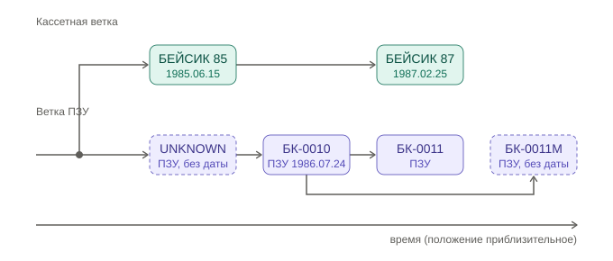

# Сравнение версий Бейсика Вильнюс для БК

Таблицы сравнения БЕЙСИК 85 и БЕЙСИК 87 (`BASIC-BK-19850615/`, `BASIC-BK-19870225/`) с базовым Бейсиком (`BASIC-BK-1985/`, ПЗУ БК-0010-01 1986.07.24 в `basic10_1..3.rom`) и с БК-0011 и БК-0011М. Первоисточники и подробности — в `README.md` обеих папок. Колонки БК-0011 и БК-0011М заполнены только известным из таблиц слов в ПЗУ (`#notes.md`); «?» означает, что не исследовалось.

## Происхождение версий

Ветки выведены владельцем репозитория из сравнения кода и таблиц; положение по оси времени приблизительное, пунктир — дата не установлена. Бирюзовым — образы, грузящиеся в ОЗУ с ленты (БЕЙСИК 85, 87), фиолетовым — образы ПЗУ. БЕЙСИК 85 отделился от ранней основной ветки раньше; ПЗУ `UNKNOWN` (`BASIC-BK-ROM-UNKNOWN/`) стоит на основной ветке перед массовым ПЗУ БК-0010 1986.07.24 (= `BASIC-BK-1985`); от него пошли ПЗУ БК-0011 и БК-0011М. Предположение владельца, не доказано датами.

## Сравнение с базовым Бейсиком
Файлы `basic01bk.bin` (1985) и `basic02bk.bin` (версия от 25.02.87) — BIN-файлы БК-0010: адрес загрузки `015174`, длина образа `022500` (9536 байт). Образ грузится в ОЗУ и от ПЗУ Фокала не зависит (проверено в эмуляторе при нулевом, `0xFF`-заполненном и подменённом ПЗУ). Используется тот же механизм `TRAP` с инлайн-строками, что и в базовом Бейсике. Сравнение сделано по таблицам слов в образах и в исходниках `BASIC-BK-1985/` (`MONIT.MAC`, `COMP.MAC`, `TRAP.MAC`); листинги лежат рядом с бинарниками (`*.dis.lst`, формат как у LST от MACRO-11: адрес, до 3 слов, инструкция, через табуляцию; получены `x-dis2.py`, проверены обратной сборкой `x-dis2-verify.py`). В бинарниках искались только ASCII-строки.

Операторы и команды:

| | Базовый BASIC-BK-1985 | БЕЙСИК 85 | БЕЙСИК 87 |
| --- | --- | --- | --- |
| Общие слова (20) | `CLEAR END FIND FOR GOSUB GOTO IF INPUT LET LINE LIST LOAD NEXT OUT POKE PRINT RETURN RUN SAVE STOP` | то же | то же |
| Полные формы вместо коротких | `DIM` `REM` `CONT` `MONIT` | `DIMENSION` `REMARK` `CONTINUE` `MONITOR` | то же |
| Только в БЕЙСИК 85/87 | нет | `EDIT` `DOT` `RANDOMIZE` | то же |
| Графика, экран, звук | `CIRCLE PAINT DRAW PSET PRESET LOCATE CLS COLOR KEY BEEP` | нет (есть `DOT`, `LINE`) | то же |
| Лента | `CLOAD CSAVE BLOAD BSAVE` | нет (есть `LOAD`, `SAVE`) | то же |
| Прочее только в базовом | `'` `?` `_` `CALL` `DEF` `TRON` `TROFF` `OPEN` `CLOSE` `READ` `DATA` `RESTORE` `ON` `LPRINT` `LLIST` `NEW` `AUTO` `RENUM` `DELETE` | нет | нет |
| Всего слов в таблице | около 58 | 27 | 27 |

Служебные слова и функции:

| | Базовый | БЕЙСИК 85 | БЕЙСИК 87 |
| --- | --- | --- | --- |
| `THEN GOTO GOSUB TO STEP` | есть | есть, инлайн в коде компилятора | есть, то же |
| `ELSE AS USR FN MOD` | есть (`RWREN` в `COMP.MAC`, `RWMOD` в `TRAP.MAC`) | в бинарнике нет | в бинарнике нет |
| `AT` `TAB` `CHR` (в `PRINT`) | есть | есть: таблица слов `022026`, обработчики `R.AT`, `R.TAB`, `R.CHR` | то же |
| Функции | ASCII-таблица, около 40 (`SIN COS TAN ATN EXP LOG SQR INT FIX ABS SGN RND PEEK LEN MID STR CHR HEX …`) | 14 числовых: `RND SQR SIN COS TAN ATA EXP LOG ABS SGN INT PEK IN KEY`, имена по три знака в упакованном виде (`FUNNAM`), ASCII-строк нет; `STR`/`HEX` работают в эмуляторе, в коде не найдены | то же; `ATA` в 87 считает неверно (см. ниже). |
| `AND OR XOR NOT IMP EQV` | есть | в бинарнике нет | в бинарнике нет |

Числа:

| | Базовый | БЕЙСИК 85 | БЕЙСИК 87 |
| --- | --- | --- | --- |
| Целое | 2 байта | 1 слово | 1 слово |
| Одинарное (Single) | 4 байта, вывод 6 цифр (`EGO`) | 4 байта (формат DEC, экспонента с отсчётом `200`) | то же |
| Двойное (Double) | 8 байт, вывод 16 цифр (`DGO`) | нет | нет |
| `CINT` `CSNG` `CDBL` | есть | нет | нет |
| Арифметика | двойная точность (`$B1 $B3 $B5 $B7`), Single расширяется нулями | только Single: `R.ADDS`, `R.SUBS`, `R.MULS`, `R.DIVS`, `R.POW`, функции `R.SQR…R.KEY`, `IS`, `SI`; около 1 КБ (`030000`–`036700`) | то же |
| Ввод числа | `PACK`: 18 цифр, 64-битная мантисса | `E.NUM` (`030454`), 7 цифр | то же |

Различия 85 и 87: таблицы слов и операторов совпадают; арифметика совпадает до слова, кроме одного (`036362`): в `R.ATA` у 87 неверное смещение `10006(SP)` вместо `6(SP)`, из-за чего `ATA(1)` = `1.000484`. Остальные отличия в начале (старт, `037422` и далее — перенос кода в хвост образа, 214 байт всего) и в возможностях: 87 принимает несколько операторов в строке через `:` или `\` (проверено в эмуляторе; в 85 — ошибка `03`) и `A=5` без `LET`. Образ 85 длиннее на 16 байт (9554 против 9538).

> Выводы раздела получены дизассемблированием, сравнением таблиц и прогоном в эмуляторе; неисследованное перечислено в конце подраздела про эмулятор и в подразделах про разбор кода.

## Сопоставление БЕЙСИК 85 и 87 с базовым Бейсиком (код)

Метод: `x-matchbase.py` (в корне). Инструкции обеих сторон нормализуются (адреса и большие константы отбрасываются), затем ищутся общие цепочки из 4 и более инструкций между образом БЕЙСИК 85/87 и ПЗУ `basic10_1..3.rom` (имена из `BASIC-BK-0010-19860724/build/BASIC.MAP`). Для 85 и 87 результат одинаков: общих блоков 21 штука, около 18% инструкций (484 из 2679 в 87).

Вывод: БЕЙСИК 85/87 **не** являются урезанной копией базового Бейсика. Общая архитектура (механизм `TRAP` со слотами пропуска, нитевой код, формат Single) та же, но код в основном написан заново, а библиотека `TRAP` другая: 14 обработчиков (`TRAP 100`–`115`) вместо 25 в базе, с иными номерами. Общие или почти общие подпрограммы:

| Образ 87 | База | Смысл |
| --- | --- | --- |
| `023474`–`023540` | `TRAP` (начало) | вход в `TRAP`-библиотеку |
| `026342`–`026416` | `SCMP` | сравнение строк |
| `030230`–`030274` | `DAUG` | размер или смещение элемента массива |
| `030326`–`030370` | `POKJMP`, `INP` | `POKE`/`OUT`/ввод порта |
| `030412`–`030430` | `STR` | преобразование в строку |
| `035062`–`035144` | `IS` | целое в одинарное (точное совпадение) |
| `035164`–`035250` | `SI` | одинарное в целое |
| `034104`–`034124` | `SSGN` | знак одинарного |
| `031302`–`031320`, `032140`–`032156` | `UNPCK` (внутри) | форматирование числа для вывода |
| `024040`–`024120` | `CISLO` (внутри) | разбор числа из текста |
| `025346`–`025404` | `AFUN` | разбор функций |
| `017116`–`017214` | `ASCCOD` | работа с кодами символов |
| `021052`–`021074`, `021464`–`021506`, `025506`–`025550` | `GRBCOL`, `BC`, `I1` | уборка текста программы и общие куски |
| `015322`–`015356`, `015546`–`015564`, `015640`–`015662` | `PIJ` (внутри) | цикл ввода строки |

Из точного совпадения `IS` и `SI` следует, что формат одинарного числа в БЕЙСИК 85/87 совпадает с базовым Single (два слова, экспонента с отсчётом `200`). Остальные подпрограммы вроде `PACK`, `FNORM`, `$B7` и двойная арифметика в БЕЙСИК 85/87 не найдены.

## Сводная таблица версий Бейсика

Колонки БК-0011 и БК-0011М заполнены только тем, что известно по таблицам слов в ПЗУ; прочерк «?» означает, что не исследовалось.

| | БК-0010-01 (ВЦКП ВГУ, 1986.07.24) | БК-0011 (1987) | БК-0011М (Экситон) | БЕЙСИК 85 | БЕЙСИК 87 |
| --- | --- | --- | --- | --- | --- |
| Где работает | ПЗУ `120000`–`177577` (микросхемы 106–108) | ПЗУ (198–200) | ПЗУ (327–329) | BIN в ОЗУ, `015174`, 9536 байт; нужен только монитор БК-0010 | то же |
| Исходники | `BASIC-BK-1985/`, пересборка `BASIC-BK-0010-19860724/` | нет | нет | нет, листинг `*.dis.lst` | то же |
| Версия по баннеру | `ВИЛЬНЮС,1986.07.24` | `Вильнюс, 1987` | `БК11/10 (с) ОКБ "Экситон"` | `ВИЛЬНЮС,1985.06.15` | `Версия от 25.02.87` |
| Операторы | около 58, короткие имена (`DIM REM CONT MONIT`) | `FIND` и `MONIT` нет; есть `MERGE FILES SCREEN WIDTH TRAP SYSTEM` | как 0010-01 плюс `MERGE`; `_`/`CALL` нет | 27, полные имена (`DIMENSION REMARK CONTINUE MONITOR`), `EDIT DOT RANDOMIZE` | то же |
| Графика | `CIRCLE PAINT DRAW PSET PRESET LOCATE CLS COLOR` | ? | ? | только `DOT`, `LINE` | то же |
| Магнитофон | `CLOAD CSAVE BLOAD BSAVE`, `LOAD SAVE` | ? | ? | `LOAD SAVE FIND` | то же |
| Целые, Single, Double | 2 / 4 / 8 байт, `CINT CSNG CDBL` | ? | ? | целое и Single | то же |
| Вывод чисел | Single 6 цифр, Double 16 | ? | ? | 7 цифр; `0.1`-мантисса теряет `1` (`1E10` = `0E 11`) | то же |
| Функции | около 40 (строковые, `MID`, `LEN`, `HEX`, `BIN`, `OCT`…) | ? | ? | 14 числовых (`RND SQR SIN COS TAN ATA EXP LOG ABS SGN INT PEK IN KEY`) + `STR` `HEX` `CHR` | то же; `ATA` неверный (лишний бит в `R.ATA`) |
| Логика `AND OR XOR NOT` | есть | ? | ? | нет | нет |
| Несколько операторов в строке | ? | ? | ? | нет (ошибка `03`) | `:` и `\` |
| Сообщения об ошибках | только номер | 33 текста | только номер | `ОШИБКА nn` (восьмеричный номер) | то же |
| Библиотека `TRAP` | 25 обработчиков (`TRAP 100`–`130`) | ? | ? | 14 обработчиков (`TRAP 100`–`115`), номера иные | то же |
| Сравнение с базой по коду | — | ? | ? | около 18% инструкций общие с 0010-01 | то же |
